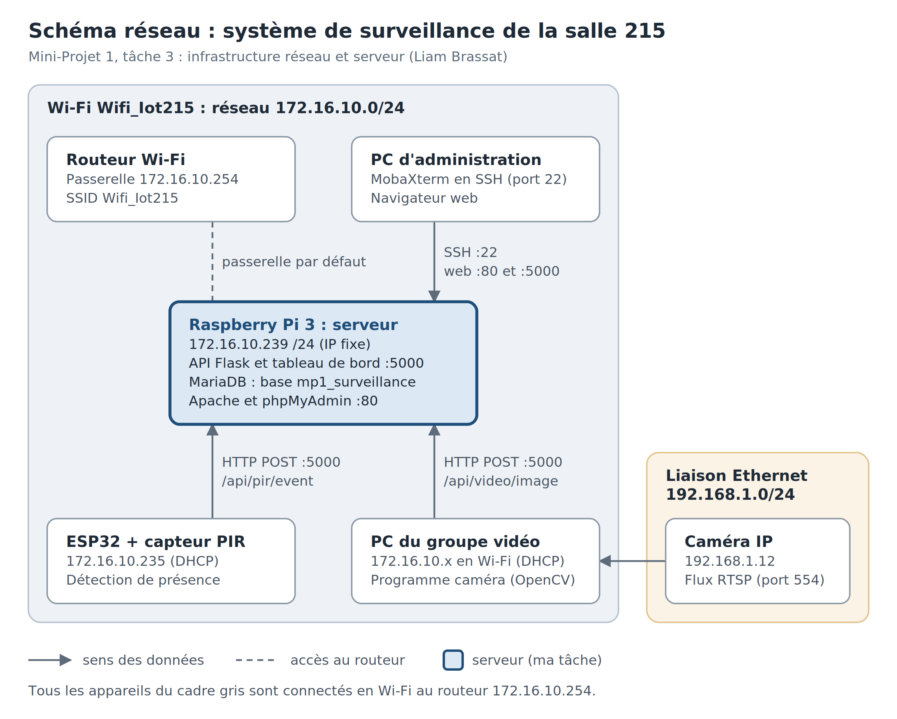

# MP1 : infrastructure réseau et serveur (salle 215)

Serveur central du système de surveillance de la salle 215 : un Raspberry Pi 3 reçoit les
détections du capteur PIR (ESP32) et les photos de la caméra, les stocke dans MariaDB et les
affiche sur un tableau de bord web.

Auteur : Liam Brassat (L.B.), tâche 3 du Mini-Projet 1.



## Arborescence

```
mp1-infrastructure/
├── README.md                  ce fichier
├── .gitignore                 exclut .env, venv/ et les photos
├── server/
│   ├── api/
│   │   ├── app.py             API Flask : capteur PIR, caméra, état de la salle
│   │   ├── images.py          réception des photos + galerie web
│   │   ├── dashboard.py       tableau de bord graphique
│   │   ├── requirements.txt   dépendances Python
│   │   └── .env.example       modèle de configuration (identifiants à remplir)
│   ├── config/
│   │   └── mp1-api.service    service systemd (démarrage automatique)
│   └── uploads/images/        photos reçues (créé automatiquement, non publié)
├── database/
│   ├── schema.sql             tables de la base mp1_surveillance
│   ├── init-db.sh             crée la base, l'utilisateur et les tables
│   └── create-admin.sh        crée un compte administrateur pour phpMyAdmin
├── docs/
│   ├── API_DOCUMENTATION.md   liste des adresses de l'API
│   └── schema_reseau.png      schéma réseau
└── tests/
    └── test_api.sh            tests automatiques de l'API
```

## Réseau

| Appareil | Adresse |
|---|---|
| Raspberry Pi (serveur) | 172.16.10.239/24, IP fixe |
| Passerelle | 172.16.10.254 |
| Réseau Wi-Fi | Wifi_Iot215 (172.16.10.0/24) |

## Installation

Sur un Raspberry Pi OS à jour, connecté en SSH.

**1. Paquets**
```bash
sudo apt update && sudo apt upgrade -y
sudo apt install -y python3-venv mariadb-server git
sudo apt install -y apache2 php libapache2-mod-php php-mysql php-mbstring phpmyadmin
```
Pendant l'installation de phpMyAdmin : cocher `apache2`, puis répondre *Yes* à dbconfig-common.

**2. Adresse IP fixe**
```bash
sudo nmcli con mod "Wifi_Iot215" ipv4.method manual ipv4.addresses 172.16.10.239/24 \
  ipv4.gateway 172.16.10.254 ipv4.dns "172.16.10.254 8.8.8.8"
sudo nmcli con up "Wifi_Iot215"
```

**3. Récupérer le projet**
```bash
git clone <URL_DU_DEPOT> ~/mp1-infrastructure
cd ~/mp1-infrastructure
```

**4. Configuration (identifiants)**
```bash
cp server/api/.env.example server/api/.env
nano server/api/.env          # remplacer les valeurs entre < >
chmod 600 server/api/.env
```

**5. Base de données**
```bash
bash database/init-db.sh       # base, utilisateur et tables (lit .env)
bash database/create-admin.sh  # compte pour phpMyAdmin (optionnel)
```

**6. API Python**
```bash
cd server/api
python3 -m venv venv
venv/bin/pip install -r requirements.txt
cd ../..
```

**7. Démarrage automatique**
```bash
sed "s/<UTILISATEUR_PI>/$USER/g" server/config/mp1-api.service | sudo tee /etc/systemd/system/mp1-api.service
sudo systemctl daemon-reload
sudo systemctl enable --now mp1-api
```

**8. Vérification**
```bash
bash tests/test_api.sh
```

## Utilisation

| Page | Adresse |
|---|---|
| Tableau de bord | http://172.16.10.239:5000/ |
| Galerie photos | http://172.16.10.239:5000/api/images |
| phpMyAdmin | http://172.16.10.239/phpmyadmin |
| État de l'API | http://172.16.10.239:5000/api/health |

## Commandes utiles

```bash
sudo systemctl status mp1-api            # état de l'API
sudo systemctl restart mp1-api           # après une modification du code
journalctl -u mp1-api -n 30 --no-pager   # messages d'erreur
mysqldump -u <UTILISATEUR_BDD> -p mp1_surveillance > sauvegarde.sql   # sauvegarde
```

## Sécurité

Aucun identifiant n'est publié dans ce dépôt. Ils sont uniquement dans `server/api/.env` sur le
Raspberry Pi, fichier exclu par `.gitignore`. Voir la notice d'utilisation pour les renseigner.
